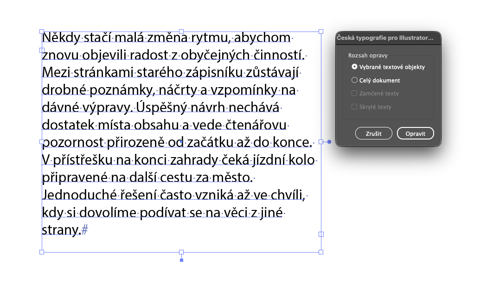
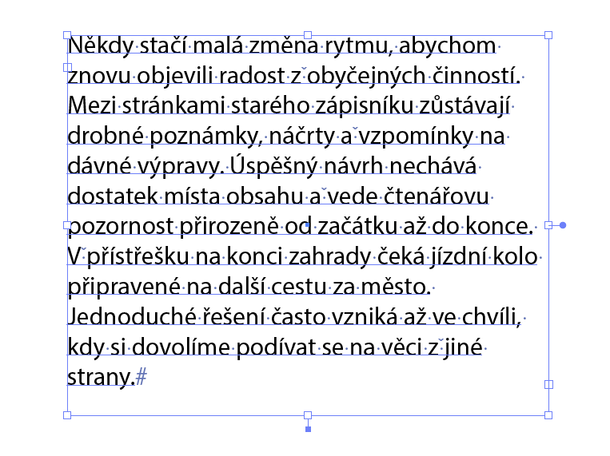
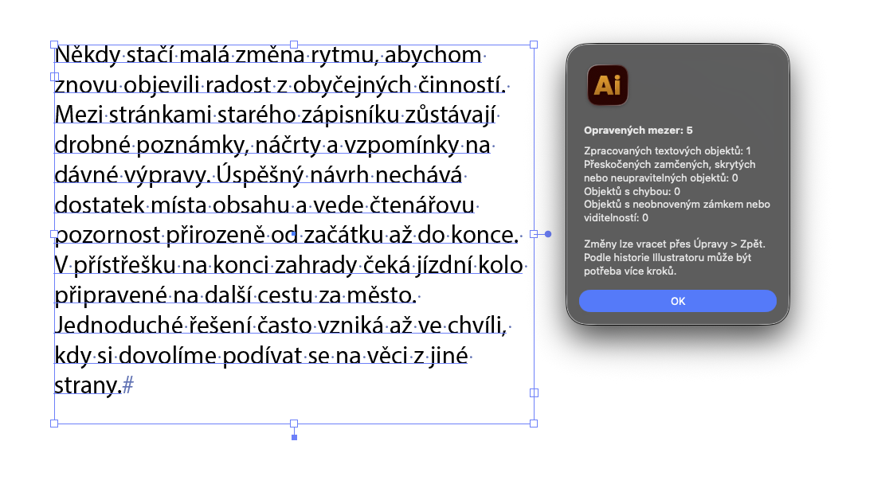
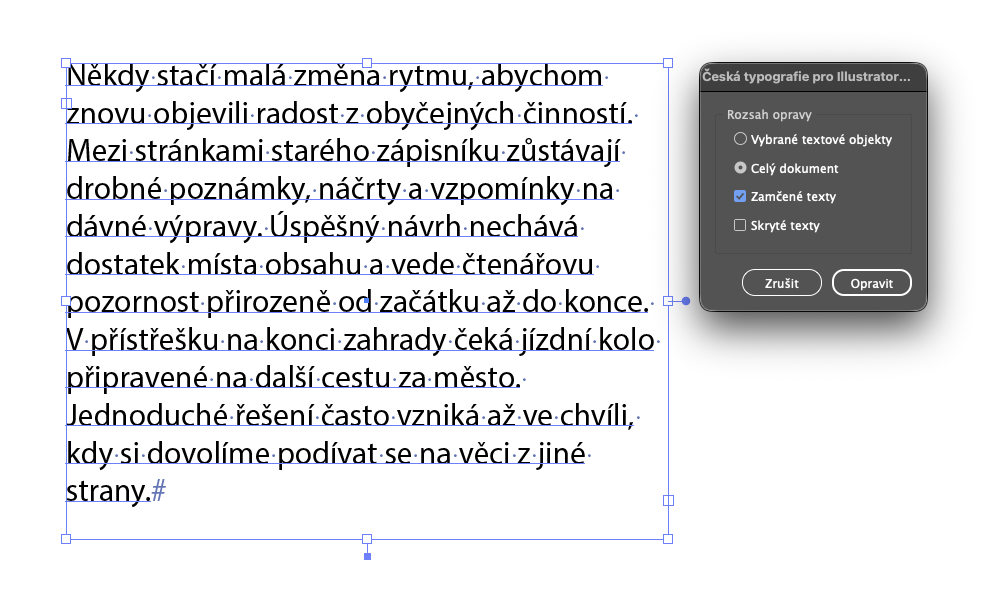

# Česká typografie pro Illustrator

JSX skript pro Adobe Illustrator 2026 na macOS. Opravuje české jednoznakové předložky a spojky nahrazením běžné mezery nezlomitelnou. Spouští se z nabídky Skripty a nabízí jednoduchý český dialog.

## Ukázky

Výběr textového objektu a dialog pro nastavení rozsahu opravy:

Textový objekt v Illustratoru po úpravě:

Souhrn po provedení oprav:

Při opravě celého dokumentu lze samostatně zahrnout zamčené texty:

## Funkce

- Opravuje slova `k, s, v, z, o, u, a, i` včetně velkých písmen.
- Zpracuje vybrané textové objekty nebo celý dokument.
- Při zpracování celého dokumentu lze samostatně zahrnout zamčené a skryté textové objekty. Obě volby jsou ve výchozím stavu vypnuté.
- Mění pouze odpovídající znak mezery, nikoli celý obsah textového objektu.
- Po dokončení zobrazí počet oprav, zpracovaných, přeskočených a chybových objektů.

## Požadavky a spuštění

Skript je určen pro Adobe Illustrator 2026 na macOS. Nevyžaduje další knihovny ani instalaci pluginu.

1. Stáhněte a rozbalte balíček vydání.
2. Otevřete dokument v Illustratoru.
3. Zvolte **File > Scripts > Other Script…** (v českém rozhraní odpovídající položku **Soubor > Skripty > Jiný skript…**) a vyberte `Ceska_typografie_pro_Illustrator.jsx`.
4. Vyberte rozsah a případné volby pro zamčené či skryté texty. Klikněte na **Opravit**.

Pokud Illustrator zobrazí varování o externím skriptu, potvrďte spuštění pouze u souboru z tohoto balíčku. Pro trvalé zařazení do nabídky Skripty lze JSX zkopírovat do složky `Scripting` v instalaci Illustratoru; po přidání souboru během běhu aplikace Illustrator restartujte.

## Rozsah opravy

**Vybrané textové objekty:** vyberte textové objekty nástrojem pro výběr. Lze vybrat i viditelnou, odemčenou skupinu s textem. Označení části textu textovým kurzorem není podporováno.

**Celý dokument:** skript projde textové objekty aktivního dokumentu. Volba **Zamčené texty** zahrne zamčené textové objekty, volba **Skryté texty** zahrne skryté textové objekty. Pro objekt, který je současně zamčený i skrytý, zapněte obě volby. Skript takový objekt dočasně zpřístupní a po opravě obnoví původní stav. Zamčené nebo skryté skupiny a vrstvy vždy přeskočí.

Změny lze vracet přes **Úpravy > Zpět** nebo panel Historie. Illustrator může opravy a dočasné změny stavu evidovat jako více kroků. Při vracení změn zkontrolujte také zámky a viditelnost textů.

## Omezení

- Nahrazuje pouze jednu běžnou mezeru `U+0020` bezprostředně za jednoznakovým slovem. Tabulátory, vícenásobné mezery, pevné konce řádků a existující nezlomitelné mezery nemění.
- Nezpracovává text převedený na křivky ani starší nepřevedené textové objekty.
- Nerozlišuje jazyk odstavce. Při volbě celého dokumentu může změnit také cizojazyčný text obsahující stejné jednoznakové výrazy.
- Není zaručen jeden společný krok Undo pro celý běh skriptu.

## Řešení problémů

Skript potřebuje otevřený dokument. Při volbě vybraných objektů je nutné vybrat textový objekt nebo skupinu s textem, nikoli jen znaky textovým kurzorem. Pokud souhrn hlásí chybu nebo neobnovený zámek či viditelnost, zkontrolujte dokument před uložením a případně použijte Undo. Při hlášení chyby přiložte znění dialogu, verzi Illustratoru a popis dotčeného textového objektu.

Konkrétní scénáře a očekávané výsledky jsou v [TESTOVANI.md](TESTOVANI.md).

## Licence

Projekt je zveřejněn pod licencí MIT. Úplné znění je v souboru [LICENSE](LICENSE).
